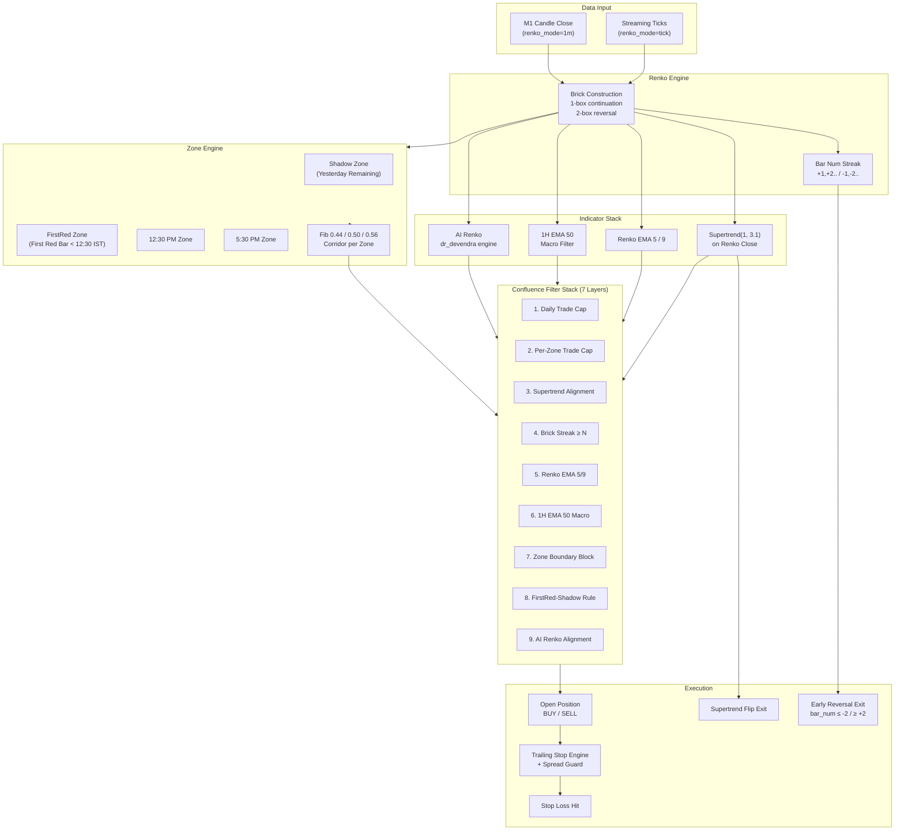
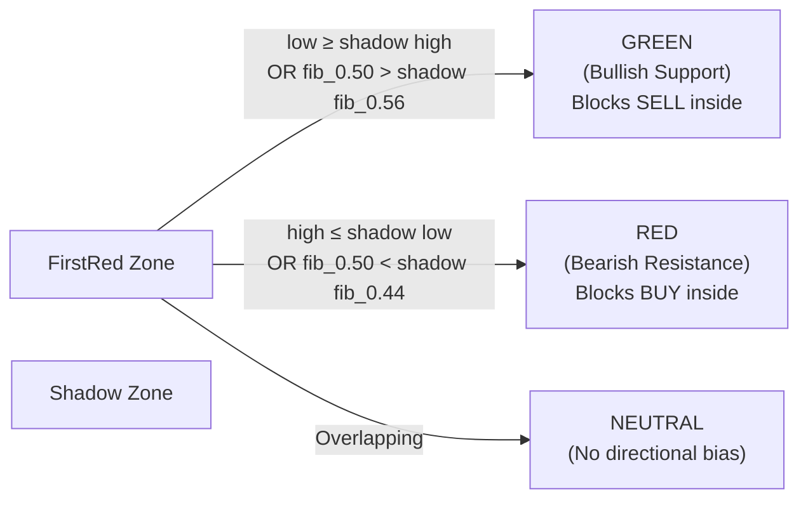
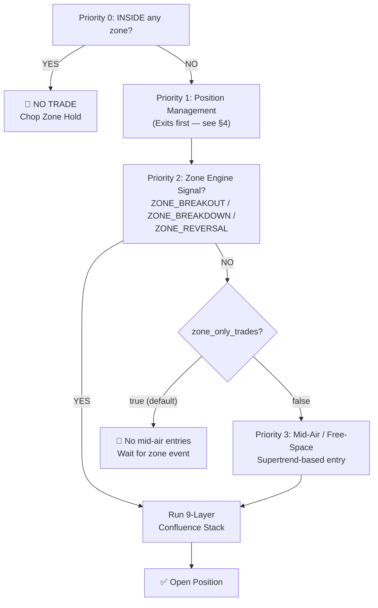
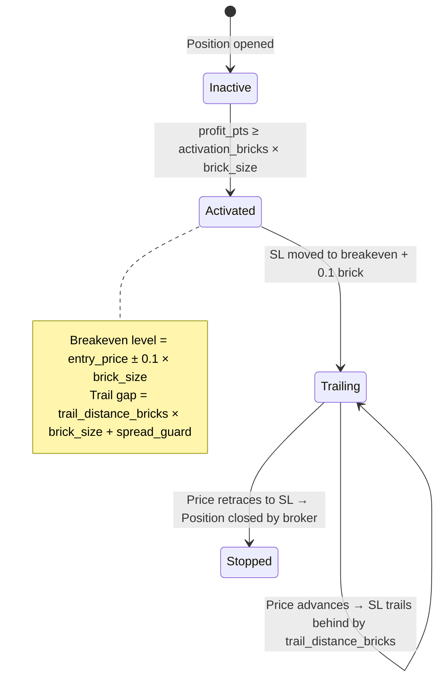

# RK Renko V4 — Entry & Exit Rules and Parameters Reference

A comprehensive deep-dive into every entry rule, exit rule, confluence filter, and configurable parameter.

---

## 1. Architecture Overview



---

## 2. Reference Zones — The Foundation

Each trading day, the bot constructs **5 structural reference zones** from specific 30-minute candles. Each zone defines a **High**, **Low**, and a **Fibonacci 0.44–0.56 equilibrium corridor**.

| Zone | Candle Source | IST Timing | Activation | Color Logic |
|------|-------------|------------|------------|-------------|
| **Shadow** | Yesterday's remaining candle | 03:30–05:30 IST (prev day) | Day start | Always `NEUTRAL` |
| **IB** (Initial Balance) | Today's first 30-min candle | ~03:30 IST | After candle closes | Always `NEUTRAL` |
| **FirstRed** | First red (close < open) 30-min candle before 12:30 IST | Variable | When found | Dynamic: `GREEN` (above shadow), `RED` (below shadow), `NEUTRAL` (overlapping) |
| **12:30PM** | 12:30–13:00 IST candle | 12:30 IST | After 13:00 IST | From candle color: `GREEN` or `RED` |
| **5:30PM** | 17:30–18:00 IST candle | 17:30 IST | After 18:00 IST | From candle color: `GREEN` or `RED` |

### 2.1 Fibonacci Corridor Calculation

For each zone with **H** (high) and **L** (low), Range **R = H − L**:

$$\text{Fib}_{0.44} = L + 0.44 \times R \quad\quad \text{Equilibrium} = L + 0.50 \times R \quad\quad \text{Fib}_{0.56} = L + 0.56 \times R$$

### 2.2 Price vs Zone Classification

```
FAR_ABOVE  │  price > candle_high         → Clear breakout
ABOVE      │  fib_0.56 ≤ price ≤ candle_high  → Between upper fib and candle boundary
INSIDE     │  fib_0.44 ≤ price ≤ fib_0.56     → ⚠ CHOP ZONE — NO TRADE
BELOW      │  candle_low ≤ price < fib_0.44   → Between candle boundary and lower fib
FAR_BELOW  │  price < candle_low           → Clear breakdown
```

> [!IMPORTANT]
> **INSIDE = absolute no-trade zone.** When price is inside any zone's 0.44–0.56 corridor, all entries are blocked regardless of other signals.

### 2.3 Zone Toggle System (Two Independent Switches per Zone)

Each zone has **two** independent boolean switches:

| Switch | Effect when `True` | Effect when `False` |
|--------|-------------------|---------------------|
| **`trade`** | Zone participates in entry/exit decisions, blocks signals, generates zone crossings/reversals | Zone is completely ignored by the trading engine |
| **`display`** | Zone appears in console banners, heartbeats, zone analysis tables | Zone is hidden from all console output (but still trades if `trade=True`) |

**Configuration sources** (priority order):
1. **CLI flags**: `--zones Shadow=on,IB=off,...` and `--zones-display Shadow=on,IB=off,...`
2. **Per-symbol overrides** in `DEFAULT_SYMBOLS_CONFIG`: `"zone_toggles": {...}`, `"zone_display": {...}`
3. **Global `ZONE_CONFIG`** at top of script (shorthand: `True`/`False` = both switches)

**Default configuration**:

| Zone | Trade | Display |
|------|-------|---------|
| Shadow | `false` | `true` |
| IB | `false` | `false` |
| FirstRed | `true` | `true` |
| 12:30PM | `true` | `true` |
| 5:30PM | `true` | `true` |

### 2.4 FirstRed ↔ Shadow Relationship (Dynamic Color Assignment)

The FirstRed zone's directional bias is determined by its spatial relationship to yesterday's Shadow:



---

## 3. Entry Rules — The Complete Signal Pipeline

### 3.1 Signal Generation Priority

Entries follow a strict priority chain. A higher-priority signal always takes precedence:



### 3.2 Zone Signal Types

| Signal Type | Trigger Condition | Description |
|------------|-------------------|-------------|
| **ZONE_BREAKOUT** | Previous brick close ≤ `candle_high`, current brick close > `candle_high`, brick is uptrend | Bullish breakout above zone's full candle boundary → `BUY` |
| **ZONE_BREAKDOWN** | Previous brick close ≥ `candle_low`, current brick close < `candle_low`, brick is downtrend | Bearish breakdown below zone's full candle boundary → `SELL` |
| **ZONE_REVERSAL** | Renko direction reversal detected inside zone's candle range, then price exits the zone in the reversal direction, confirmed by Supertrend | Price reverses inside a zone and then breaks out in the new direction |

> [!NOTE]
> **Reversal > Crossing priority**: When both a reversal and a crossing signal exist for the same brick, the reversal always wins. The reversal requires a prior direction change (tracked per-zone in `_pending_zone_reversals`), followed by an exit crossing the candle boundary in the reversal direction, with Supertrend confirmation.

### 3.3 The 9-Layer Confluence Filter Stack

Every candidate signal (zone or mid-air) must pass **all 9 filters** in sequence. Any single filter blocks the entry:

| Layer | Filter | BUY Condition | SELL Condition | Parameter | Default |
|-------|--------|--------------|----------------|---------------|---------|
| **1** | Daily Trade Cap | `total_daily_trades < max_daily_trades` | Same | `max_daily_trades` | `12` |
| **2** | Per-Zone Trade Cap | `zone_trades[zone] < max_trades_per_zone` | Same | `max_trades_per_zone` | `4` |
| **3** | Supertrend Direction | `st_dir == +1` (Bullish) | `st_dir == -1` (Bearish) | `entry_mode` | `confluence` |
| **4** | Brick Streak | `bar_num ≥ zone_streak_bricks` | `bar_num ≤ -zone_streak_bricks` | `zone_streak_bricks` | `3` |
| **5** | Renko EMA 5/9 | `EMA5 > EMA9` | `EMA5 < EMA9` | `no_renko_ema` | `false` (enabled) |
| **6** | 1H EMA 50 Macro | `brick_close ≥ ema50_h1` | `brick_close < ema50_h1` | `no_h1_ema50` | `false` (enabled) |
| **7** | Zone Boundary Block | No `RED` zone has price `INSIDE` | No `GREEN` zone has price `INSIDE` | (implicit) | always on |
| **8** | FirstRed-Shadow Rule | See §3.4 below | See §3.4 below | `firstred_shadow_rule` | `false` |
| **9** | AI Renko Alignment | AI Renko `status == READY` AND `direction == +1` | AI Renko `status == READY` AND `direction == -1` | (always on) | — |

> [!WARNING]
> The **Whipsaw Filter** (`min_trend_bricks`) applies as an additional gate specifically for mid-air (non-zone) Supertrend signals: `|bar_num| ≥ min_trend_bricks_filter` is required. Zone breakout/breakdown signals bypass this filter.

### 3.4 FirstRed-Shadow Rule (Optional Advanced Filter)

When `firstred_shadow_rule = true`, additional structural logic gates entries:

| Scenario | Allowed Signals | Logic |
|----------|----------------|-------|
| FirstRed **above** Shadow | BUY only (SELL blocked) | Bullish structural support; selling into support is prohibited |
| FirstRed **below** Shadow, price has NOT crossed above max(firstred.high, shadow.high) | SELL only (BUY blocked) | Until price proves it can break above both levels |
| FirstRed below Shadow, price HAS crossed above | Only 12:30PM zone entries (until 17:30 zone forms) | After crossing, entries are restricted to the 12:30 zone only |
| After 17:30 zone forms | Normal rules resume | All zones and directions allowed |

This rule persists across restarts via persistent state storage.

### 3.5 Mid-Air / Free-Space Entries (when `zone_only_trades = false`)

When zone-only mode is OFF, mid-air entries use Supertrend confluence:

```python
buy_confluence = (
    st_dir == 1 and
    bar_num >= min_trend_bricks_filter and
    (not use_renko_ema_filter or ema5_renko > ema9_renko)
)
sell_confluence = (
    st_dir == -1 and
    bar_num <= -min_trend_bricks_filter and
    (not use_renko_ema_filter or ema5_renko < ema9_renko)
)
```

Triggers on:
- **Supertrend flip** (immediate entry if confluence met)
- **FLAT position + active Supertrend direction** (re-entry after exit)

### 3.6 Entry Mode Variants

| Mode | Setting Value | Behavior |
|------|-----------|----------|
| **confluence** | `entry_mode = confluence` | Zone signals with full 9-layer stack + optional mid-air Supertrend entries |
| **supertrend** | `entry_mode = supertrend` | Identical to confluence (same code path) |
| **reversal** | `entry_mode = reversal` | Strict 2-brick Renko reversal only: `bar_num == ±1` confirmed by Supertrend |
| **trend** | `entry_mode = trend` | Trend continuation: any brick in Supertrend direction triggers entry when flat |

---

## 4. Exit Rules

### 4.1 Exit Priority (checked on every new brick)

| Priority | Exit Type | Condition | Parameter Setting |
|----------|----------|-----------|-------------|
| **1** | **Supertrend Flip Exit** | Supertrend direction reverses against the open position (BUY + ST becomes BEAR, or SELL + ST becomes BULL) | Always active |
| **2** | **Early Reversal Exit** | Long: `bar_num ≤ -2` (two confirmed bearish bricks); Short: `bar_num ≥ +2` (two confirmed bullish bricks) | `no_early_exit = false` → enabled |
| **3** | **Stop Loss Hit** | Broker-side SL execution (triggered at market by MT5) | `sl_bricks` |
| **4** | **Trailing Stop Hit** | Trailing SL catches up to price after activation | `trail_bricks`, `trail_act` |
| **5** | **Take Profit Hit** (optional) | Either R-multiple TP or zone-edge TP | `tp_r` |

### 4.2 Trailing Stop Engine (Tick-Level, Runs Every Tick)

The trailing stop runs independently on **every tick** (not just brick events):



**Spread Guard mechanism** protects against artificial stop-outs:
- Maintains a rolling average spread: `avg_spread = 0.95 × avg_spread + 0.05 × current_spread`
- **Pauses** trailing updates when `current_spread > 1.5 × avg_spread` (spike detected)
- Adds `spread × spread_guard_mult` to the trailing distance (default 1.0× = full spread offset)

**For BUY positions**: `proposed_sl = bid - trail_gap - spread_guard` (SL only moves UP)
**For SELL positions**: `proposed_sl = ask + trail_gap + spread_guard` (SL only moves DOWN)

### 4.3 Stop Loss Calculation

| Method | Condition | Formula |
|--------|-----------|---------|
| **Fixed Brick SL** (default) | `use_supertrend_sl = false` | BUY: `entry - (sl_bricks × brick_size)` / SELL: `entry + (sl_bricks × brick_size)` |
| **Supertrend SL** (optional) | `use_supertrend_sl = true` | SL = Supertrend line value, with minimum safety buffer of `1.5 × brick_size` |

### 4.4 Take Profit Calculation

| Method | Condition | Formula |
|--------|-----------|---------|
| **No TP** (default) | `tp_r = 0.0` | Run to Supertrend flip (position stays open until ST reverses) |
| **R-Multiple TP** | `tp_r > 0` (e.g., 2.0) | `TP = entry ± (tp_r × |entry - SL|)` |
| **Zone Edge TP** | `use_zone_tp = true` | BUY TP = nearest zone's `fib_0.44` ABOVE price; SELL TP = nearest zone's `fib_0.56` BELOW price |

---

## 5. Complete Configuration Parameter Reference

### 5.1 `[general]` Section

| Parameter | Type | Default | Description |
|-----------|------|---------|-------------|
| `symbols` | CSV string | `EURUSD,AUDUSD,USDJPY,GBPUSD,XAUUSD,EURJPY,BTCUSD` | Comma-separated symbols for multi-symbol mode |
| `symbol` | string | (empty) | Single-symbol mode override; leave blank for multi-symbol |
| `dry_run` | bool | `false` | ⚠ `false` = real MT5 orders; `true` = paper trading simulation |
| `main_hours` | int | `22` | Hours in main trading session (determines shadow candle split) |
| `lot_size` | float | `0.01` | Default lot size (overridden per-symbol) |
| `date` | string | (empty) | Specific date override for backtesting; leave blank for live |

### 5.2 `[strategy]` Section

| Parameter | Type | Default | Description |
|-----------|------|---------|-------------|
| `entry_mode` | string | `confluence` | Signal generation mode: `confluence`, `supertrend`, `reversal`, `trend` |
| `sl_bricks` | float | `5.0` | Stop loss distance in Renko bricks |
| `tp_r` | float | `0.0` | Take profit as R-multiple (0.0 = run to Supertrend flip) |
| `trail_bricks` | float | `4.0` | Trailing stop distance behind market in bricks |
| `trail_act` | float | `4.0` | Trailing stop activation threshold in bricks of profit |
| `no_trailing_stop` | bool | `false` | Set `true` to disable trailing stop entirely |
| `use_supertrend_sl` | bool | `false` | Peg SL to Supertrend line instead of fixed brick distance |
| `min_trend_bricks` | int | `2` | Anti-whipsaw filter: minimum consecutive bricks for mid-air entries |
| `zone_streak_bricks` | int | `3` | Required brick streak for zone confluence confirmation (3, 4, or 5) |
| `spread_guard` | float | `1.0` | Multiplier of spread added to trailing distance |
| `renko_mode` | string | `1m` | `1m` = form bricks on completed 1-minute candle close; `tick` = real-time tick |
| `max_trades_per_zone` | int | `4` | Daily trade limit per individual zone |
| `max_daily_trades` | int | `12` | Hard daily cap across ALL zones (3 zones × 4 = 12) |
| `no_zones` | bool | `false` | Master kill-switch: disables entire zone engine |
| `no_zone_only` | bool | `false` | Set `true` to allow mid-air (free-space) entries alongside zone entries |
| `no_h1_ema50` | bool | `false` | Set `true` to disable 1H EMA 50 macro filter |
| `no_renko_ema` | bool | `false` | Set `true` to disable Renko EMA 5/9 momentum filter |
| `no_early_exit` | bool | `false` | Set `true` to disable early reversal exit on bar_num ±2 |
| `firstred_shadow_rule` | bool | `false` | Enable the advanced FirstRed-Shadow structural gate |

### 5.3 `[zones.trade]` and `[zones.display]` Sections

| Parameter | Trade Default | Display Default | Notes |
|-----------|--------------|-----------------|-------|
| `shadow` | `false` | `true` | Used as reference for FirstRed classification; trading off by default |
| `ib` | `false` | `false` | Initial Balance; both off by default |
| `firstred` | `true` | `true` | Primary intraday entry zone |
| `12:30pm` | `true` | `true` | London open corridor zone |
| `5:30pm` | `true` | `true` | London/NY overlap zone |

### 5.4 `[symbol:XXX]` Per-Symbol Overrides

| Parameter | Description | Example |
|-----------|-------------|---------|
| `magic` | Unique magic number for position isolation | `777001` |
| `lot` | Lot size for this symbol in multi-symbol mode | `0.01` |
| `divisor` | ATR divisor for brick size calculation: `brick = ATR(5) / divisor` | `22` |

---

## 6. Brick Size — Dynamic ATR-Based Sizing

### 6.1 Formula

$$\text{brick\_size} = \frac{\text{ATR}(5)_{\text{session}}}{\text{divisor}}$$

| Asset Class | Session Hours | ATR Period | Divisor | Example |
|------------|---------------|-----------|---------|---------|
| **Gold (XAUUSD)** | 22H | 5 | 22 | ATR=45.0 → brick=2.05 |
| **Forex Majors** | 22H | 5 | 22 | ATR=0.37 → brick=0.017 |
| **Crypto (BTCUSD)** | 23H | 7 | 23 | Varies |

### 6.2 Auto-Recalculation

At each **new trading day rollover** (detected when tick timestamp crosses midnight):
1. Fetches 15 days of session-split candles
2. Calculates ATR(5) using Wilder's RMA
3. Updates `brick_size = ATR(5) / divisor`
4. Recalculates all thresholds (`next_up`, `next_down`)
5. Refreshes all zone levels (Shadow, IB, FirstRed, 12:30, 5:30)
6. Resets daily trade counters and syncs from MT5 deal history

---

## 7. Indicator Specifications

| Indicator | Source | Parameters | Purpose |
|-----------|--------|-----------|---------|
| **Supertrend** | Renko brick Close (not High/Low) | Length=1, Multiplier=3.1 | Primary trend direction; +1 BULL, -1 BEAR |
| **Renko EMA 5** | Renko brick Close | Period=5 | Fast momentum confirmation |
| **Renko EMA 9** | Renko brick Close | Period=9 | Slow momentum confirmation |
| **1H EMA 50** | 1-Hour candle Close (from MT5) | Period=50 | Macro trend filter; cached 60s |
| **AI Renko** | dr_devendra_ai_smart_renko on M1 bars | ATR(14), ST(3.1), ADX(14/14/15) | Independent trend confirmation gate |
| **Bar Num** | Renko streak counter | Cumulative ±1 per brick | Trend strength measurement |

---

## 8. Trade Safety Mechanisms

| Mechanism | Description | Controlled By |
|-----------|-------------|---------------|
| **Hedge Prevention** | Before opening, verifies no opposing position exists; never opens BUY + SELL simultaneously | Always active |
| **Single Instance Lock** | PID-based lock mechanism prevents duplicate bot processes on same account/symbol | Instance Lock |
| **Magic Number Isolation** | Each symbol has unique magic; bot never touches manual trades or other bots' positions | `magic` per symbol |
| **Spread Spike Guard** | Pauses trailing stop updates when spread > 1.5× rolling average | `spread_guard` |
| **Trade History Sync** | On startup and daily reset, syncs actual trade counts from MT5 deal history | Automatic |
| **Broker Validation** | Validates SL/TP against broker tick size and minimum stop distance before sending | Always active |

---

## 9. Worked Example — Full Signal Lifecycle

```
1. 12:30 PM IST candle closes → Zone "12:30PM" becomes available
   High=2650.50, Low=2648.30, Fib44=2649.27, Fib50=2649.40, Fib56=2649.53

2. Price drops below zone... bar_num reaches -4 (bearish streak)

3. Renko brick closes at 2648.10 (below candle_low 2648.30)
   → Zone engine: ZONE_BREAKDOWN detected on "12:30PM"
   → Candidate signal: SELL

4. Confluence filter stack:
   ✅ Layer 1: Daily trades = 3/12
   ✅ Layer 2: 12:30PM zone trades = 1/4
   ✅ Layer 3: Supertrend = BEARISH (-1)
   ✅ Layer 4: bar_num = -4 ≤ -3 (streak requirement met)
   ✅ Layer 5: EMA5 (2649.1) < EMA9 (2649.8) — bearish momentum
   ✅ Layer 6: brick_close (2648.1) < 1H EMA50 (2650.3) — bearish macro
   ✅ Layer 7: No GREEN zone has price INSIDE
   ✅ Layer 8: FirstRed-Shadow rule N/A
   ✅ Layer 9: AI Renko status=READY, direction=-1 — aligned

5. ★ ZONE CONFLUENCE CONFIRMED ★ → SELL executed
   Entry: 2648.10 | SL: 2648.10 + (5.0 × 2.05) = 2658.35

6. Trailing stop activates after +4 bricks of profit (at ~2639.9)
   SL moved to breakeven: 2648.10 - 0.1×2.05 = 2647.90
   Then trails: ask + (4.0 × 2.05) + spread_guard

7. Exit: Supertrend flips to BULL on completed brick → immediate close
```

---

> [!NOTE]
> The **Shadow** and **IB** zones have `trade=false` by default in the configuration. This means only **3 zones** (FirstRed, 12:30PM, 5:30PM) actively generate trade signals. The Shadow zone is used only as a structural reference for classifying FirstRed's directional bias.
